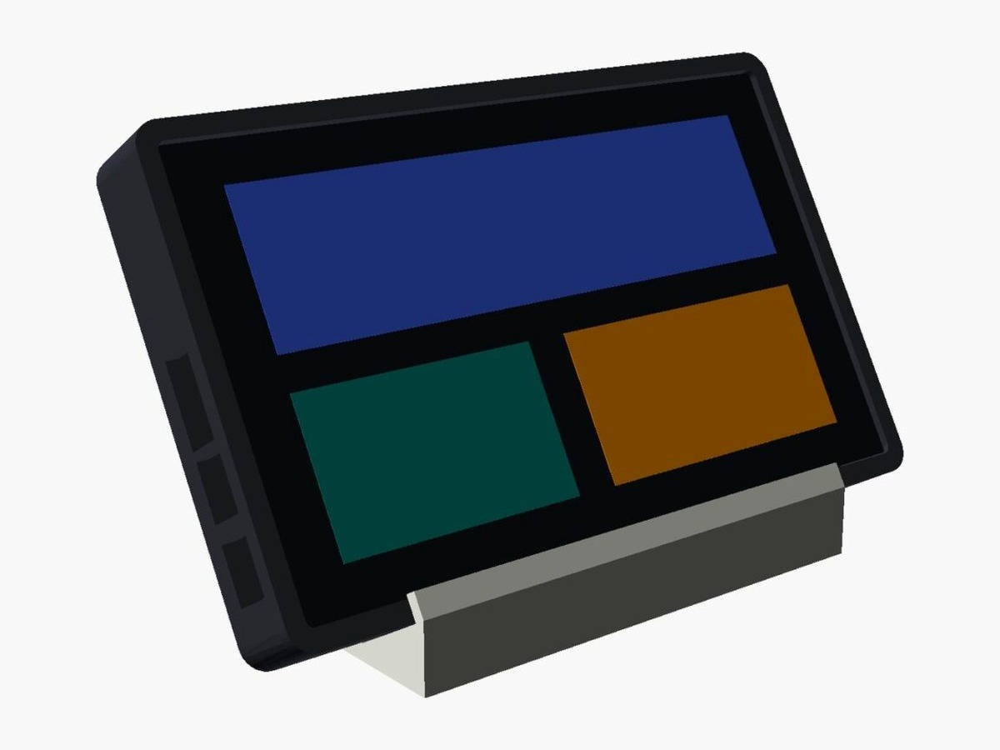
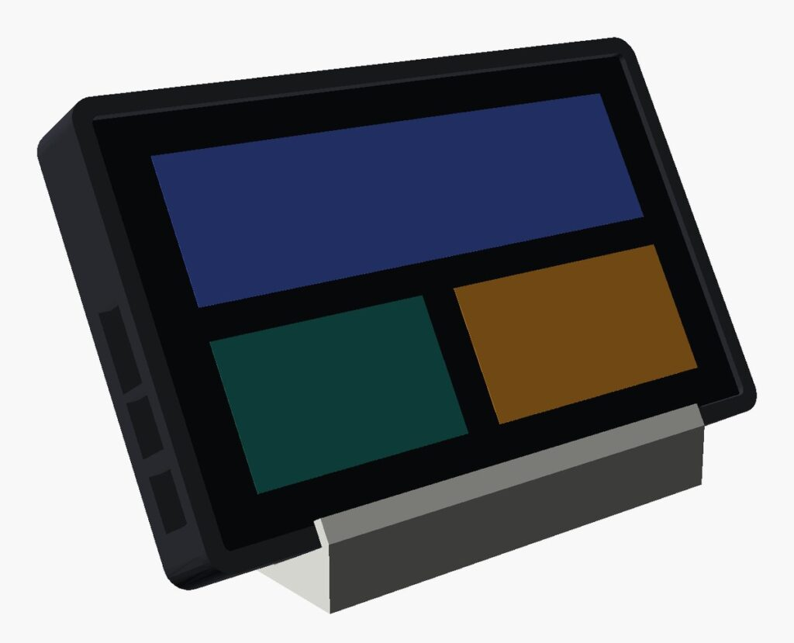
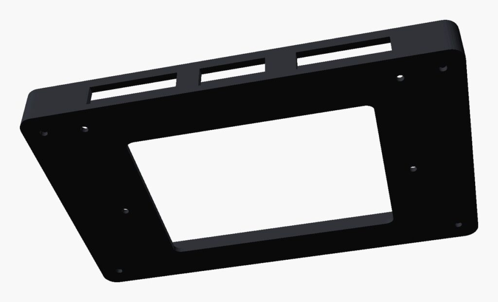
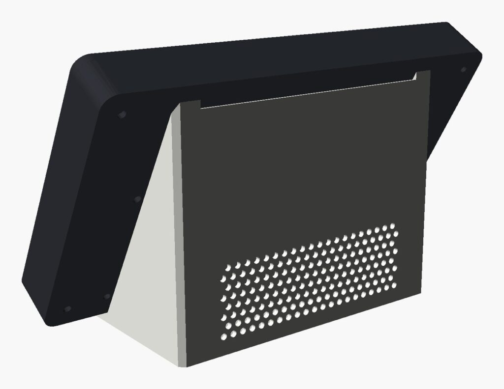

# Real-time Formula 1 and football dashboard on ESP32-P4 7″

> 📖 **Full article with photos, explanations and solved problems (in Italian):**
> **[www.emgi.it – Real-time Formula 1 and football dashboard on ESP32-P4 7″ with 3D-printed case](https://www.emgi.it/2026/10/04/dashboard-formula-1-calcio-tempo-reale-esp32-p4-case-3d/)**
>
> More electronics, Arduino, ESP32, Home Assistant and 3D printing projects at **[www.emgi.it](https://www.emgi.it)**

Desk display showing **Formula 1 and football in real time**, with no app, account or API key, and **sound alerts** for goals, leader changes, Safety Car and flags. Arduino firmware with LVGL 9, 3D-printed case with desk stand and speaker bay.

## Features

**Formula 1**
- Live timing of practice, qualifying and race: positions, gaps, intervals, pit stops, retirements, lap, flags, SC/VSC, race control messages
- Overtaking arrows (positions gained/lost)
- Drivers' and constructors' standings and result of the last race
- Circuit map (official MultiViewer outline) with the **estimated position** of the cars; tap a driver in the list to show or hide it (ALL / NONE buttons, choice saved)
- Tyres of every driver with official colours and laps covered

**Football**
- Serie A (with standings), Nations League, Champions League, Europa League, Euros, World Cup
- Matches from 2 days before to 7 days after, updated every 60 s (20 s with matches in progress)
- Match detail: timeline, statistics, line-ups; sent-off indicator

**Sound alerts** synthesised by the firmware (no audio files): goals, whistles, red cards, F1 start, new leader, Safety Car/VSC/red flag, chequered flag.

**Other:** standby after 2 minutes with wake-up on touch or on an alert, configuration web page (saved in NVS), HTTP API for Home Assistant.

## Hardware

| Component | Notes |
|---|---|
| Waveshare **ESP32-P4-WIFI6-Touch-LCD-7B** | 7″ 1024×600 MIPI-DSI, GT911 touch, ESP32-P4 + ESP32-C6 (WiFi 6), ES8311 codec |
| Speaker | the one supplied with the board |
| 5 V USB-C power supply | |
| Small screws | to close bezel and body |

## Data sources (all public, no registration)

| Data | Source |
|---|---|
| Matches, results, Serie A standings, match detail | ESPN (`site.api.espn.com`) |
| F1 standings, last race, calendar | Jolpica (`api.jolpi.ca`) |
| F1 live timing, tyres, finish-line crossings | `livetiming.formula1.com` (SignalR over WebSocket) |
| Circuit outlines | MultiViewer (`api.multiviewer.app`), downloaded once and saved in NVS |

> The live timing sends the GPS coordinates of the cars (`Position.z`) only to F1 TV subscribers: the position on the map is therefore estimated from each driver's last crossing of the finish line and last lap time.

## Arduino IDE

- **Espressif esp32 core 3.3.x** (tested with 3.3.12). ⚠️ Do not use core 4.0 (alpha): `ESP32_Display_Panel` 1.0.4 does not compile with ESP-IDF 6.
- **Libraries:** ESP32_Display_Panel, ESP32_IO_Expander, esp-lib-utils, lvgl 9.x, ArduinoJson 7.x

| Setting | Value |
|---|---|
| Board | ESP32P4 Dev Module |
| Chip Variant | Before v3.00 |
| PSRAM | Enabled |
| Flash Size | 16MB (128Mb) |
| Partition Scheme | 16M Flash (3MB APP/9.9MB FATFS) |
| USB Mode | Hardware CDC and JTAG |

The first build takes about 15 minutes.

## Installation

1. Clone or download the repository and open `sport_p4/sport_p4.ino`.
2. In **`sport_p4/AppConfig.h`** enter the SSID and password of your WiFi network (`YOUR_NETWORK` / `YOUR_PASSWORD`). It is the only file to edit.
3. Build and upload over USB-C.
4. Open `http://sport-p4.local` (or the IP shown on the serial monitor) for the configuration.

**HTTP API:** `GET /api/stato` (status) · `POST /api/imposta` (settings, e.g. `luce=40` for brightness) · `POST /api/prova?s=gol` (sound test)

**Serial commands (115200 baud):** `d` sound test · `m` alerts on/off · `g` simulate a goal · `f` simulate an F1 alert

## Wiring

The **Waveshare ESP32-P4-WIFI6-Touch-LCD-7B** board already integrates display, touch, WiFi (ESP32-C6) and audio codec: there are no wires to solder.

| Connection | Where |
|---|---|
| Speaker (supplied) | the board's **SPK / speaker** connector (ES8311 codec output) |
| Power and programming | the board's **USB-C** port, **5 V** power supply (at least 2 A) |

- Connect the speaker **before** closing the case: the cable runs from the body to the stand's bay.
- To upload the sketch use a USB-C data cable (not charge-only).

## 3D-printed case

STL files in the [`case_3d`](case_3d) folder:

| Part | Dimensions | File |
|---|---|---|
| Bezel | 174 × 109 × 5.4 mm | `case_esp32_p4_bezel.stl` |
| Body | 174 × 109 × 17.5 mm | `case_esp32_p4_body.stl` |
| Stand (easel with speaker bay) | 120 × 73 × 93 mm | `case_esp32_p4_stand.stl` |
| Speaker bay cap | 112 × 15.5 × 3 mm | `case_esp32_p4_cap.stl` |

**Printing:** PLA, 205 °C / bed 60 °C, 0.2 mm layers, 3 perimeters, 20% infill. Bezel and body with the flat face on the bed; stand on its base (check in the slicer whether the shelf of the speaker bay needs supports).

**Assembly:** upload the sketch, connect the speaker, close the board between bezel and body with the screws, put the speaker in the stand and close it with the cap.

## License

- Code: [MIT](LICENSE)
- 3D models and images: [CC BY-SA 4.0](https://creativecommons.org/licenses/by-sa/4.0/)

---

**Author:** Massimiliano Sandrin – **[eMGi.it](https://www.emgi.it)** · Questions and comments below the [article on the website](https://www.emgi.it/2026/10/04/dashboard-formula-1-calcio-tempo-reale-esp32-p4-case-3d/).
